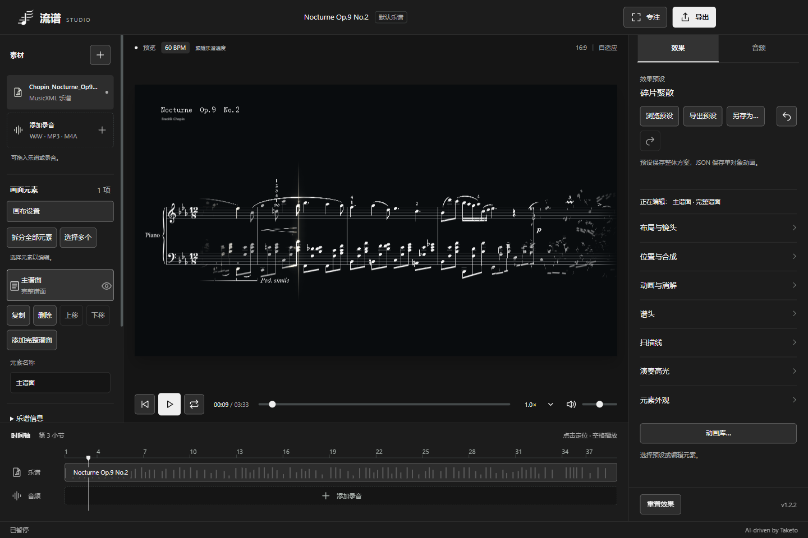
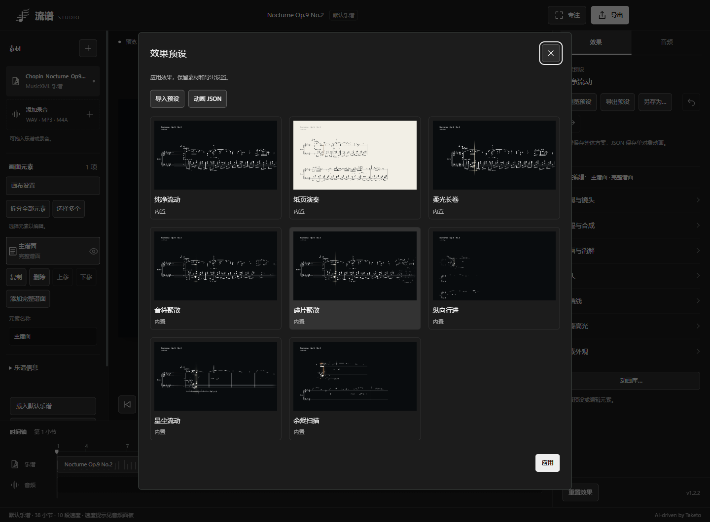
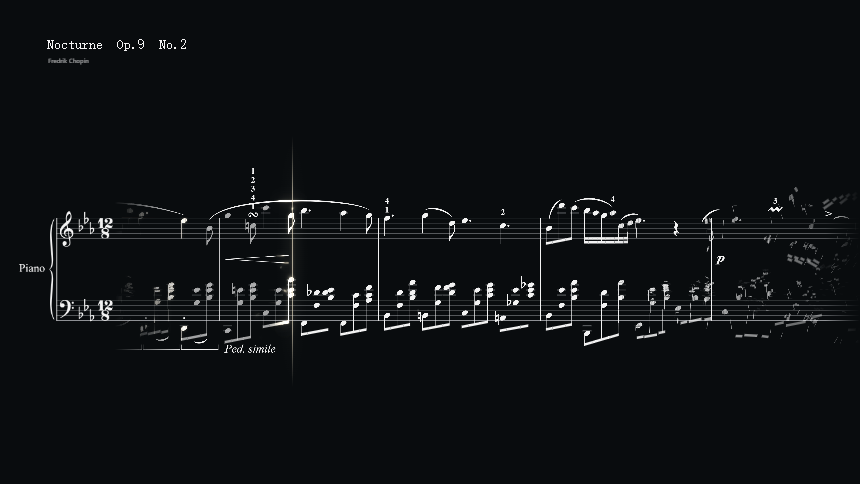
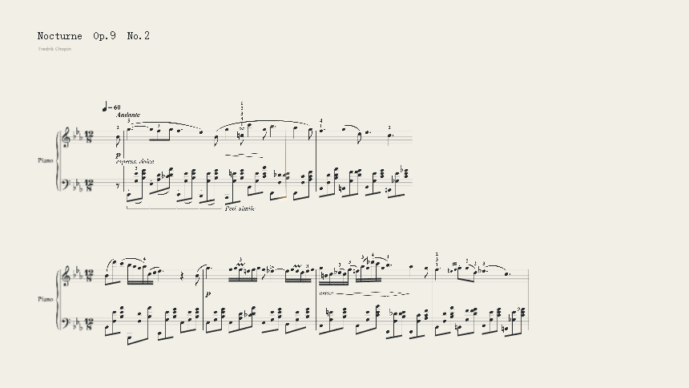
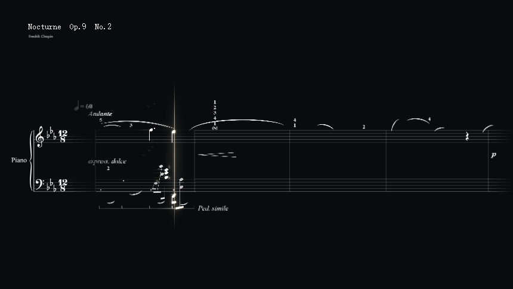
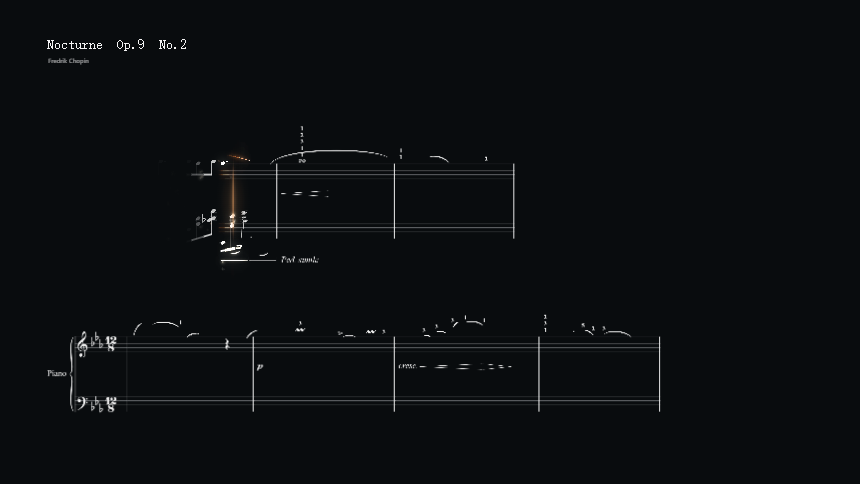
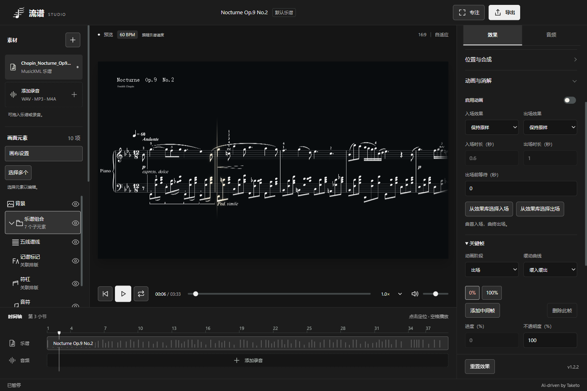
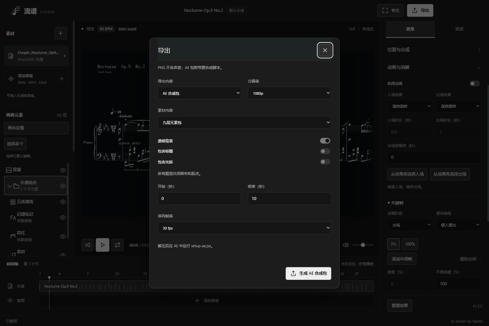
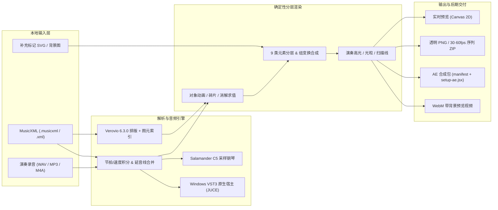

<div align="center">
  
  <h1>流谱 Studio</h1>
  <p><strong>MusicXML 乐谱影像创作工作台 · Web 工作台与 Windows 桌面端</strong></p>
  <p>
    <code>v1.2.2</code> ·
    <code>Windows 10/11 x64</code> ·
    <code>Node.js 20+</code> ·
    <code>Electron 44.9</code> ·
    <code>Verovio 6.3.0</code>
  </p>
  <p>
    <a href="#核心特性">核心特性</a> ·
    <a href="#界面与成片展示">界面与成片展示</a> ·
    <a href="#架构与工作流">架构与工作流</a> ·
    <a href="#快速开始">快速开始</a> ·
    <a href="#内置音源与-vst3-宿主">音源与 VST3</a> ·
    <a href="#after-effects-单向合成交付">AE 导出</a> ·
    <a href="#项目文档索引">文档索引</a>
  </p>
</div>

**流谱 Studio** 是一款专注于乐谱演奏视频创作的本地工作台，提供纯本地网页端与 Windows 桌面端。项目使用 Verovio 与 Bravura 音乐字体对 MusicXML 进行真实矢量排版，内置采样钢琴与 Windows x64 VST3 原生宿主，支持多图层拆分编组、关键帧动效、消解粒子以及面向 After Effects 的分层透明序列交付。默认内置肖邦《夜曲 Op.9 No.2》（`Chopin_Nocturne_Op9_No2.musicxml`），所有乐谱、录音与预设均在本地处理，不向外部上传文件。



---

## 核心特性

- **MusicXML 真实排版与音画同步**：自动解析 `.musicxml` / `.xml`（score-partwise）中的数字速度标记、小节内变速、附点拍号与反复结构；同音延音线自动合并发声，和弦视觉退场等待最长持续音成员。
- **自由组合的排版与镜头**：支持**连续长卷**与**多行排版**（每行 1–12 小节、每页 1–8 行、10–1000% 缩放），搭配**连续跟随**、**固定画面**与**分段 / 翻页**镜头；谱头支持随谱移动后停靠、随谱移动、每行独立或隐藏，中途临时谱号、调号与变拍拍号按实际位置平滑接管。
- **9 类元素拆分与编组合成**：一键将完整谱面拆分为五线谱线、记谱标记、符杠、音符、演奏光效、谱头、扫描线 7 个乐谱子层，以及独立的背景与标题层；支持同级编组、整组复制、混合模式（正常 / 滤色 / 正片叠底 / 叠加发光）与 ±120 秒视觉时间偏移。
- **20 种动画阶段与多模式消解**：音符与符杠、五线谱线、记谱标记分别配置入场与出场阶段，支持可视化关键帧编辑、0–5000% 碎片聚散与时间驱动关键帧；谱面消解提供余烬、微尘、柔和淡出与保持可见，支持小节后等待或实时跟随播放进度。
- **精细化演奏高光与扫描线**：提供「脉冲」与「拂处生辉」两种亮度时间曲线，以及「柔和光晕」与「边缘泛光」空间算法；支持按音符、符杠、谱号、调拍号、休止符、力度标记、连线/延音线、歌词分别开关高光；扫描线支持独立颜色、长度、宽度、旋转、偏移与收尖光晕。
- **8 套内置完整预设与本地预设库**：按由简到繁内置纯净流动、纸页演奏、柔光长卷、音符聚散、碎片聚散、纵向行进、星尘流动、余烬扫描，支持 `.liupu-preset`（v5，兼容导入 v1–v4）与单对象动画 JSON 导入导出。
- **内置采样钢琴与 Windows VST3 宿主**：开箱内置 Salamander Grand Piano V3（Yamaha C5 三力度层 90 个立体声采样）；支持连接独立 JUCE 原生宿主加载本地 Windows x64 `.vst3` 乐器插件并打开插件原生编辑界面。
- **透明分层导出与 AE 自动建合成**：支持当前帧 PNG、30/60 fps 透明 PNG 序列 ZIP、带背景 WebM 预览视频，以及三层 / 九层 AE 合成包（附带 `manifest.json` 与自动创建合成的 `setup-ae.jsx`）。
- **多语言与本地隐私保护**：支持中文 / 日本語 / English 界面切换与黑白、珊瑚、青绿、冰蓝四套 UI 配色；UI 设置与成片像素完全隔离，默认仅绑定本机回环地址运行。

---

## 界面与成片展示

### 八套内置完整效果预设

预设库按视觉复杂度由简到繁组织，涵盖静态纸页教学、连续长卷柔光以及强氛围的余烬与微尘消解方案，并支持用户另存、删除与 `.liupu-preset` 跨设备导入导出。



### 成片渲染效果对比

| 碎片聚散（横向长卷 · 碎片聚拢与飘散） | 纸页演奏（浅色多行 · 轻量高光） |
| :---: | :---: |
|  |  |
| **星尘流动（微尘消解 · 光粒与长拖尾）** | **余烬扫描（多行扫描 · 进度驱动焚毁）** |
|  |  |

### 元素拆分、关键帧与 AE 分层导出

| 元素拆分与动画关键帧编辑 | After Effects 合成包导出面板 |
| :---: | :---: |
|  |  |

---

## 架构与工作流

预览与离线导出共用 `CompositionRenderer` 确定性求值管线：任意时间点或拖动定位都会按绝对乐谱时间重建同一帧画面，不依赖增量粒子状态。



---

## 快速开始

### 方式一：下载 Windows 桌面版（推荐）

前往仓库右侧的 **Releases** 页面下载最新版本 `v1.2.2`（适用于 Windows 10 / 11 x64，已内置 Electron、Verovio、Salamander 钢琴采样与 VST3 宿主，无需安装 Node.js）：

- **免安装版**：`Liupu-Studio-1.2.2-win-x64.zip` — 完整解压至可写文件夹后，直接双击 `Liupu Studio.exe` 运行（请保留完整解压目录，勿单独移动 EXE）。
- **安装版**：`Liupu-Studio-1.2.2-Setup-x64.exe` — 默认仅为当前用户安装并创建快捷方式。

> 提示：程序当前未进行商业代码签名，首次运行时 Windows Defender SmartScreen 可能提示未知发布者。更多桌面端细节与校验信息见 [DESKTOP.md](DESKTOP.md)。

### 方式二：从源码运行网页工作台

需要 **Node.js 20 或更高版本**。构建完成后运行时无需外网或 CDN。

```powershell
npm install --ignore-scripts
npm run build
npm start
```

启动后在浏览器中打开：`http://127.0.0.1:4173`

若本机系统默认 npm 缓存目录不可写，可指定本地缓存目录安装依赖：

```powershell
npm install --ignore-scripts --cache .npm-cache --registry https://registry.npmjs.org
```

### 方式三：桌面端开发与从源码打包

桌面端完整打包需要 **Node.js 22.12+**、**Windows x64**、**Visual Studio 2022（使用 C++ 的桌面开发）** 与 **Windows SDK**：

```powershell
# 1. 构建独立 JUCE VST3 原生宿主（首次运行将拉取固定提交的 JUCE 并校验 SHA-256）
npm run build:native

# 2. 调试启动 Electron 桌面端
npm run desktop

# 3. 打包生成 Windows 安装程序与免安装 ZIP（输出至 release\1.2.2\）
npm run package:win -- --config.directories.output=release\1.2.2

# 4. 校验打包资源、ASAR 模块、90 个钢琴采样与第三方许可完整性
node scripts/check-package.mjs release\1.2.2
```

### 自动化测试

```powershell
npm test
```

当前核心单元测试套件包含 241 项测试，覆盖乐谱解析、速度映射、延音合并、分层编组、动画阶段、高光渲染、缓存策略、AE 导出安全与本地服务端点。浏览器端实机渲染检查可在构建后执行 `node scripts/prepare-browser-qa.mjs` 并访问 `/browser-qa.html` 运行；详细验收记录见 [QA.md](QA.md)。

---

## 使用说明与快捷操作

- **界面设置与主题**：点击左上角 Logo 打开软件设置，支持实时切换 `中文` / `日本語` / `English` 与黑白（默认）、珊瑚、青绿、冰蓝配色。界面语言与 UI 配色仅保存在本机，不影响乐谱内容、预设或导出成片。
- **素材与同步**：点击播放即可试听默认的《夜曲 Op.9 No.2》，也可直接将 `.musicxml` / `.xml` 乐谱、音频（WAV / MP3 / M4A 等）或背景图（PNG / JPEG / WebP）拖入窗口；点击时间轴定位，按 `Space` 播放或暂停。
- **快捷键与桌面控制**：桌面版采用融合标题栏，支持拖动顶部空白区移动窗口；`F11` 切换全屏，`F1` 或左下角「帮助与说明」查看文档与许可，`Ctrl +` / `Ctrl -` / `Ctrl 0` 缩放界面；下拉框支持鼠标悬停后滚轮快速切换，数值框回车立即提交。
- **SVG 辅助补全**：选中完整谱面或记谱标记层后，在「效果 -> 元素外观 -> SVG 辅助与记谱检查」可下载原始排版 SVG，在矢量编辑器中保留原 `viewBox` 补画特殊标记并导回「补充 SVG」（外部资源与脚本会被安全过滤）。

---

## 内置音源与 VST3 宿主

### 默认钢琴：Salamander Grand Piano V3

项目内置 Alexander Holm 录制的 Yamaha C5 三角钢琴采样（取自 `tambien/Piano` 第 3、8、13 力度层，覆盖 A0–C8 共 90 个立体声 MP3，约 15.69 MiB，采用 CC BY 3.0 许可）。支持相邻力度层等功率混合、自然衰减、离键淡出、总线动态压缩，以及从长音中间位置续播；播放倍速仅改变乐谱时值而不改变音高。完整校验清单与许可原文保留在 [src/assets/piano/README.md](src/assets/piano/README.md)。

### Windows x64 VST3 乐器（实验功能）

网页端通过本机 Node 服务与独立进程 `native/bin/LiupuVSTHost.exe`（基于 JUCE 8.0.12）进行 JSON 行协议通信：

1. 在右侧「音频 -> 播放乐器」选择 `VST3 乐器 · Windows`。
2. 点击「导入 VST3 乐器」，通过原生文件选择器选取已安装的 `.vst3` 插件。
3. 点击「打开乐器窗口」在插件自身界面中挑选音色后即可同步播放。

**当前边界**：每次仅支持加载一个 Windows x64 VST3 乐器并输出至系统默认声卡；不支持 VST2 `.dll`、ASIO 设置、插件状态随工程保存或 WebM 直接录入 VST3 声音（若需导出带 VST3 音轨的视频，请在 DAW 渲染音频后导入流谱对齐导出；PNG / AE 序列不受影响）。协议与编译细节见 [native/README.md](native/README.md)。

---

## After Effects 单向合成交付

流谱负责乐谱排版、节拍时序与透明图层渲染，After Effects 负责后续滤镜、插件、表达式与最终音频合成：

1. 点击右上角「导出」，选择「AE 合成包 · 分层素材 + 自动建合成」。
2. 设置 1080p / 720p、30 / 60 fps 与时间范围，选择「三层包（谱面 / 演奏光效 / 扫描线）」或「元素分层包 · 9 层」。
3. 下载并完整解压 ZIP 后，在 After Effects 中执行 **文件 -> 脚本 -> 运行脚本文件**，选择包内的 `setup-ae.jsx`。
4. 脚本会自动创建合成、按 Straight / Unmatted Alpha 导入全部序列图层、配置混合模式与源时间标记；随后在 AE 中另行导入音频并按时间标记对齐。

> 注意：为保证浏览器离线生成稳定性，单包限制最多 1800 张 PNG 或 600 MB，长曲请分段导出；详细格式见 [AE-EXPORT.md](AE-EXPORT.md)。

---

## 当前限制

- 本机可保存最多 50 套个人视觉预设并支持撤销 / 重做（30 步），但尚未实现包含乐谱、录音与插件状态的完整工程保存与恢复。
- 同作品最多包含 24 个乐谱元素层、合计 64 个元素或组（背景与标题各限 1 个）。
- 暂未开放 `.mxl` 压缩谱导入；MusicXML 单文件上限为 4 MB、3000 个音符与单声部结构 256 小节。
- 外部录音目前仅支持整体起点偏移（±30 秒）与变速（会同步改变音高），尚未支持逐小节自由速度锚点对齐；纯文字 `rit.` / `accel.` 不会自动生成渐变曲线。
- 暂不支持离线 MP4、4K 或 ProRes 4444 编码输出，透明通道动画通过 PNG 序列交付。

---

## 项目文档索引

| 文档 | 内容说明 |
| --- | --- |
| [COMPOSITION.md](COMPOSITION.md) | 完整预设、排版与镜头组合、9 类元素拆分与编组规则 |
| [EFFECTS.md](EFFECTS.md) | 20 种动画阶段、关键帧、碎片聚散、消解时机与演奏高光算法 |
| [AE-EXPORT.md](AE-EXPORT.md) | After Effects 合成包目录结构、`manifest.json` 规范与导入指南 |
| [DESKTOP.md](DESKTOP.md) | Windows 桌面端安装使用、快捷键、版本特性与源码打包说明 |
| [MOTION-DESIGN.md](MOTION-DESIGN.md) | v1.2.x 效果工作台架构、预设模型与渲染合成顺序说明 |
| [DESIGN.md](DESIGN.md) | 工作台视觉系统、配色令牌、品牌图标规范与交互约定 |
| [PRODUCT.md](PRODUCT.md) | 产品目标、核心创作流程与阶段性功能取舍 |
| [QA.md](QA.md) | 各版本（含 v1.2.2 性能与回归）自动化测试与实机验收记录 |
| [方案设计.md](方案设计.md) | 早期产品与技术路线设计方案 |
| [native/README.md](native/README.md) | Windows VST3 原生宿主架构、进程通信协议、构建与测试说明 |

---

## 开源组件与许可边界

- **Verovio 6.3.0**（`LGPL-3.0-or-later`）：用于 MusicXML 排版，构建时作为未修改的独立模块复制至 `dist/vendor/` 并保留归属与许可。上游仓库：[rism-digital/verovio](https://github.com/rism-digital/verovio)。
- **Salamander Grand Piano V3**（`CC BY 3.0`）：Alexander Holm 录制，采样取自 [tambien/Piano](https://github.com/tambien/Piano/tree/0cd2c034f820c53e83ab22f5c13bd490b9e4de85/audio)，完整来源、校验清单与许可文件随项目保留于 [src/assets/piano/](src/assets/piano/README.md)。
- **Windows VST3 原生宿主（`native/`）与 JUCE 8.0.12**（`AGPL-3.0-only`）：独立宿主源码、构建脚本与许可说明位于 [native/](native/README.md)，随桌面版分发时会在安装包 `resources/licenses/` 中完整附带宿主及对应版本的 JUCE / Verovio 源码包与声明（见 [desktop/THIRD-PARTY-NOTICES.md](desktop/THIRD-PARTY-NOTICES.md)）。
- **Electron 44.9.1**：桌面运行时及其内置 Chromium / Node.js 许可随发行包一同保留。
- 本项目服务端 `server.mjs` 仅监听本机回环地址，不提供外网上传接口；公开示例与文档仅供学习与本地创作使用，用户自行加载的第三方商业 VST3 插件与音色库授权由各厂商决定。
