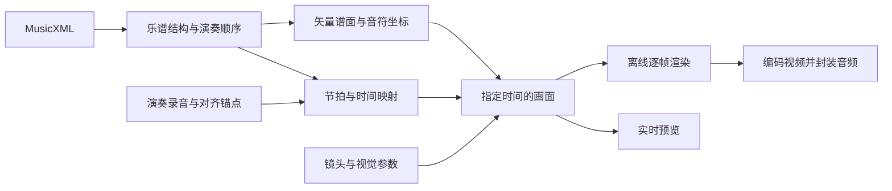

# 流谱 Studio：乐谱影像创作方案

本方案针对“制作高质量乐谱演奏视频”。已确认先做网页原型，再考虑桌面封装。
“流谱 Studio”是工作名称；以下把已经实现的原型和正式产品规划分别说明。

## 产品主张

从 MusicXML 乐谱与演奏录音出发，制作清晰、流畅、音画一致的音乐影像。
主流程是：导入 → 同步 → 视觉设计 → 审看 → 输出。

最值得投入的三件事是谱面质量、真实演奏同步、可复现的成片渲染。
特效以服务乐句和声部为准，不让粒子遮住节奏，也不把每个音符都做成强闪光。

## 参考站的观察

[Score Scroll](https://www.score-scroll.cn/) 当前页面展示了 SVG 乐谱、MIDI 速度、音频输入，音频补偿、BPM、进度，以及飘入距离、散落范围、碎片延迟、高光范围/强度/大小、扫描线位置、吸顶位置等控制。
页面还展示主题、音乐字体、背景和 MP4 / PNG 导出选项。

初次访问覆盖界面与选项。第二轮读取了公开前端文件，确认其按图元偏移、旋转与透明度实现右侧聚合，并在音头附近做分层辉光；节拍时间由 MIDI 速度事件积分。证据和限制保存在本地归档 `artifacts/reference-score-scroll/findings.md`（未纳入版本库）。没有对参考站完整动画、同步准确度或视频输出进行实测，也不将界面选项等同于兼容性认证。

我们借鉴“乐谱参与运动、高光与扫描线共同组织注意力”，为视频制作重新设计工作台，并以 MusicXML 为输入源。

## 成片风格与运动模式

| 模式 | 观看方式 | 优先场景 | 实现顺序 |
|---|---|---|---|
| 横向流动 | 扫描线固定，谱面连续从右向左经过 | 钢琴、器乐、旋律视频 | 原型已实现 |
| 分段扫描 | 当前横向片段固定，扫描线推进，片段末尾切换 | 相对稳定的读谱画面 | 原型已实现基本形式 |
| 上下行接力 | 当前系统保持稳定，下一系统提前进入，完成后平滑接替 | 合唱、室内乐、阅读型视频 | 下一轮可选核心方向 |
| 页面镜头 | 保留完整总谱，镜头跟随系统或声部移动 | 管弦总谱、多声部讲解 | 正式版扩展 |

建议的预设：

- **纯净**：强调精确排版、稳定镜头与音符状态；原型已有。
- **辉光**：暖色活动音、音头光晕与拖尾、轻量聚散；原型已有。
- **纸页**：浅背景深谱线，适合教学和古典作品；原型已有画布主题。
- **星尘**：音符进入和离开时有明显碎片、起音光粒和分层辉光；v0.2 默认预设。
- **声部对话**：为不同声部指定颜色和强调程度，按音乐结构改变焦点；规划。

运动质量的关键是“什么时候发生”：
进入应为即将演奏的音符提供提前量；高光跟随真实音符时值；离开应避开仍在持续的长音；镜头跨系统时提前预告；反复回跳要有独立规则。
当前原型的飘入/消散主要按画面位置计算，正式版需要把时值、连音和乐句结构加入运动规则。

## 完整功能蓝图

| 模块 | 正式版应提供 | 当前原型 |
|---|---|---|
| 乐谱导入 | .musicxml、.xml、.mxl；导入诊断；多声部选择；原始谱保留 | .musicxml / .xml 的 score-partwise；尺寸和格式检查 |
| 记谱兼容 | 连音、连奏、复调、连符、弱起、反复、跳房、调拍号变化、歌词、打击乐 | 交给 Verovio 排版；未完成广泛兼容性认证 |
| 音频 | WAV / MP3 等录音；波形；高质量音源；轨道增益 | 浏览器录音与波形、Salamander 三层采样钢琴、实验性 Windows VST3 原生宿主；VST 音频尚未回传视频 |
| 同步 | 起点对齐；逐小节锚点；变速曲线；手动微调；可选自动对齐建议 | MusicXML 数字速度表、小节内变速、整体录音偏移与统一播放倍率 |
| 动效 | 多种流动模式；音符/声部着色；高光、拖尾、聚散；参数关键帧 | 横向流动、分段扫描、碎片聚散、辉光、光粒、拖尾和扫描线设置 |
| 画面 | 背景图片/视频；标题、署名；画幅；安全区；多声部布局 | 三种比例、自定义背景/音符/高光颜色、背景图片与遮罩、曲名与乐谱大小 |
| 制作 | 区间审看；片头片尾；段落标记；效果预设；撤销重做 | 时间轴定位、循环、播放速度 |
| 项目 | 保存/打开；自动恢复；素材重定位；工程打包；模板 | 尚未实现持久化，刷新会恢复演示 |
| 输出 | 1080p/4K；30/60fps；离线 MP4；透明序列；队列与取消恢复 | PNG、实时 WebM，目标 30fps、720p/1080p |
| 桌面 | 离线素材、音源管理、渲染队列、后台导出 | 架构方向，尚未封装 |

首版不扩展为完整制谱编辑器。修改音符、OCR、练琴评分和云端协作各自都属于另一套复杂产品流程。

## MusicXML 与同步引擎

数据应明确分成：

1. **原始乐谱**：保留原始文件、作曲者、声部、记谱结构。
2. **演奏顺序**：将反复、跳房和转段展开为演奏实例；同一个音符可以在多个播放时刻出现。
3. **节拍到时间映射**：建立四分音符单位的节拍位置与演奏录音时间关系。
4. **图形索引**：音符 ID、谱表、坐标、包围盒及关联符号。
5. **视觉工程**：镜头、主题、预设、字幕、画幅和输出参数。

MusicXML 自带的速度无法自动描述一段自由速度录音。固定 BPM 和一次起点补偿只能解决简单情况。
正式版的核心交互应是：在波形上选择一个明确起音点，将它对应到乐谱中的某小节/某拍，再添加下一锚点；相邻锚点间建立单调的时间映射，提供局部试听和撤销。
自动对齐只先输出可检查的候选锚点，不应静默覆盖用户校准。

当前使用 [Verovio 输入](https://book.verovio.org/toolkit-reference/input-formats.html)、[SVG 与时间映射](https://book.verovio.org/toolkit-reference/output-formats.html)。
Verovio 的秒时间映射在小节内变速与附点速度上有实测偏差。v0.2 使用它的四分音符位置和演奏顺序，另从 MusicXML 提取 `sound tempo` 与 `metronome` 数字速度，积分生成准确的秒时间，并提供反向映射。相机在节拍坐标上插值，避免长音中途的速度节点被略过。测试覆盖小节内变速、附点单位、重复、弱起与多声部冲突；广泛的复杂曲谱认证仍待完成。
只有 `rit.` / `accel.` 文字而没有数字节点时会显示提示，不猜测渐变曲线。导入录音仍按原有时序播放，尚未依据乐谱速度自动伸缩或对齐。
[OpenSheetMusicDisplay](https://github.com/opensheetmusicdisplay/opensheetmusicdisplay/wiki/Getting-Started) 是值得以真实曲谱集对比的备选排版引擎；先做兼容性比较，再确定长期选型。

## 渲染与导出

建议核心接口为 `renderFrame(project, time)`：

预览按音频时钟取样当前时间；正式导出以 `frame / fps` 计算帧时刻。
随机效果必须使用固定种子，跳转、重开工程和导出应保持同一视觉状态。
音频在输出时按同一映射处理，不能依赖“边播放边录屏”作为最终制作管线。

原型采用 Canvas 2D 和缓存的谱面/音符图层；暂不引入高成本 3D 引擎。
大编制与长曲需要进一步做可见区域裁剪、谱面分块、Worker 排版和 GPU 合成的实测。
桌面壳等浏览器端的渲染和同步契约稳定后再定；以文件访问、后台编码、分发体积及真实机器性能决定，不提前锁定。

## 交互细节

- 新用户打开即有原创演示曲；导入入口与播放操作无需跳转页面。
- 格式错误时解释原因、保留上一份有效乐谱。
- 更换乐谱后清除旧录音关联，避免无意把不匹配的音频当作同步结果。
- 录制中锁住影响画面的控件，提供取消；页面进入后台时取消实时录制并说明原因。
- 导出面板明确写出实际格式，不把 WebM 命名成 MP4。
- 默认文件仅在浏览器本地处理。正式工程保存需提供素材重定位与隐私说明。
- 正式版要明确显示未保存状态、音频缺失和导入兼容性警告。

## 分阶段落地

**阶段一：验证视觉与主流程。** 本次网页原型。用真实谱面讨论流动方式、布局、可读性和动效强度。

**阶段二：完成制作闭环。** MXL 导入、完整项目保存、波形锚点同步、基本关键帧、稳定的离线 1080p MP4、录音与谱面兼容性测试。

**阶段三：提高成片质量。** 4K/60fps、GPU 视效、采样音源、声部配置、段落镜头、导出队列与桌面封装。

v0.3 已补上固定谱头、符杠播放动画、组件独立配色/不透明度，以及 30/60 fps 透明 PNG 序列与分层包。SVG 辅助层接受原始谱面同坐标的补充标记。后续优先工程保存、任意录音的时间对齐及离线视频编码。

## 建议的验收标准（目标，不是当前测试结果）

- 音画同步：与人工标定样本比较，正常条件下误差目标小于 20ms；逐拍、变速和反复分别测。
- 帧稳定性：明确参考硬件与乐谱规模后设定预览目标；导出按帧数验收，不以实时预览帧率代替。
- 确定性：同一工程、同一帧时间和种子，重启后输出相同布局与特效位置。
- 导入质量：准备钢琴、声乐、弦乐、合唱和复杂复调样本，覆盖反复、弱起、三连音、跨谱表与速度变化。
- 工程完整性：保存重开不丢设置；移动素材后可重新关联；异常关闭可恢复。
- 长片输出：完整曲目的视频时长、音频时长和总帧数一致；取消不破坏原工程。

## 下一轮建议讨论

已按用户选择优先固定谱头的横向流动与合成元件输出。下一轮用真实 MusicXML 样本检查特殊标记、跨谱表和声部；SVG 只补充视觉，不能替代音乐时间语义。再据实际画面讨论字号、谱线亮度、光晕与聚散强度。
